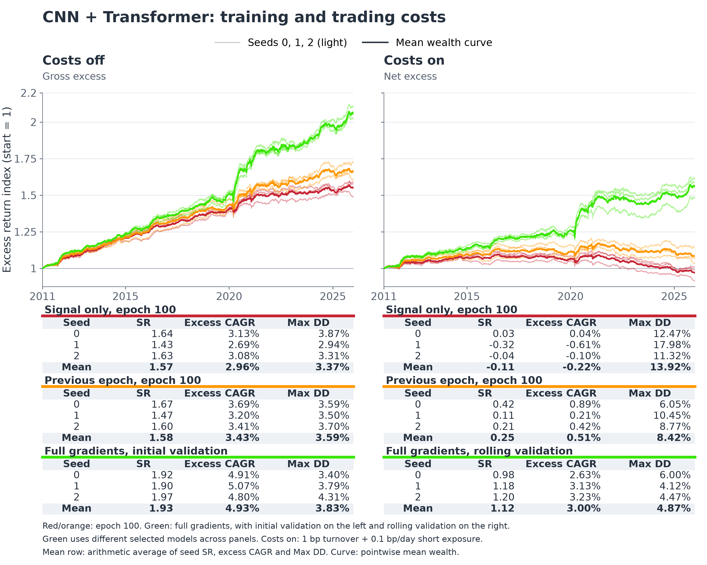

# DLSASeqGrad

Deep learning statistical arbitrage with sequential gradients. An extension of [*Deep Learning Statistical Arbitrage*](https://doi.org/10.1287/mnsc.2022.03132)
by Guijarro-Ordonez, Pelger, and Zanotti.

**Our contribution:** a training procedure that accounts for transaction costs
and **propagates gradients through sequential asset allocations within
minibatches**, together with **checkpoint selection based on validation net
Sharpe ratio (SR)**.

**[Full results and training diagnostics (PDF)](results.pdf)**

| Evaluation | Best mean Sharpe ratio | Reproduced paper baseline |
| --- | ---: | ---: |
| Before costs | **1.927** | 1.568 |
| After costs | **1.120** | 0.245 |



We reproduce and extend two architectures from the paper: a convolutional neural
network (CNN) with a Transformer encoder, and a Fourier transform with a
feed-forward network (FFN). Both operate on five-factor principal component
analysis (PCA) residuals from a fixed panel of 500 stocks.

The configurations with the highest mean SR both use full gradients through
current holdings, with **initial validation** before costs and **rolling
validation** after costs. The reference configurations use signal-only training
at epoch 100 before costs and previous-epoch cost-aware training at epoch 100
after costs. These comparisons evaluate implementations on the same dataset;
the published paper reports results for a different sample.

Each **Mean** row reports the arithmetic average of the three seed-level
statistics: annualized Sharpe ratio, excess compound annual growth rate (CAGR),
and maximum drawdown. Each statistic is calculated from the individual seed's
complete return path. The **Mean wealth curve** is the pointwise average of the
three compounded excess-return indices; table statistics are averaged separately.
The evaluation covers 3,772 trading sessions, January 2011–December 2025. Costs are
1 basis point (bp) per unit of stock-level $L^1$ turnover and 0.1 bp per day per
unit of short exposure. Results before costs evaluate the same fitted models
with both charges set to zero.

## Portfolio construction

### 1. Excess returns and PCA residuals

The model uses $N=500$ stocks, $K=5$ factors, and a signal lookback of $L=30$ days.
At the close of day $t$, observe stock excess returns
$R_t=R_t^{\mathrm{act}}-R_t^{\mathrm{rf}}\mathbf{1}\in\mathbb{R}^N$
and choose weights $w_t$ for the next day's return $w_t^{\mathsf T}R_{t+1}$.

Let $Q_t\in\mathbb{R}^{N\times K}$ be the PCA factor portfolios and
$B_t\in\mathbb{R}^{N\times K}$ their stock loadings. Define the residual map
and each historical residual by

$$
\Phi_t=I_N-B_tQ_t^{\mathsf T},
\qquad
\varepsilon_s=\Phi_{s-1}R_s.
$$

At close $t$, factors use the 252 returns ending at $t$; loadings use the last
60 of those observations. Each historical residual uses its own preceding
factor estimate. The signal input is a cumulative residual path:

$$
x_{n,t}^{(\ell)}=\sum_{j=1}^{\ell}\varepsilon_{n,t-L+j},
\qquad \ell=1,\ldots,L.
$$

### 2. Signals, residual allocations, and stock weights

The signal and allocation functions act on each stock's path, with parameters
shared across stocks:

$$
z_{n,t}=f_\theta(x_{n,t}),
\qquad u_{n,t}=g_\psi(z_{n,t}).
$$

| Model | Signal $f_\theta$ | Allocation $g_\psi$ |
| --- | --- | --- |
| CNN + Transformer | CNN $1\to8\to8$, then a four-head Transformer; final 8-dimensional token | Linear head $v^{\mathsf T}z+b$ |
| Fourier + FFN | 30 real coordinates from the unnormalized real fast Fourier transform (FFT) | FFN $30\to16\to8\to4\to1$, with rectified linear unit (ReLU) hidden activations |

Residual allocations $u_t$ are converted into stock holdings by netting their
factor hedges, then normalizing total absolute exposure:

$$
\widetilde w_t=\Phi_t^{\mathsf T}u_t
             =u_t-Q_t(B_t^{\mathsf T}u_t),
\qquad
w_t=\frac{\widetilde w_t}{\lVert\widetilde w_t\rVert_1}.
$$

Zero allocations correspond to a cash position. All other portfolios have
$\lVert w_t\rVert_1=1$ and may contain both long and short positions.

## Trading costs and the learning objective

Cost-aware models incorporate the previous stock holding in the **final linear output layer**:
$g_\psi(z,h)=g_\psi^{\mathrm{signal}}(z)+a h$, with $a$ initialized to zero.
For lagged holdings $h_{t-1}$, net excess return is

$$
\widetilde R^p_{t+1}
=w_t^{\mathsf T}R_{t+1}
-c_{\mathrm{tr}}\lVert w_t-h_{t-1}\rVert_1
-c_{\mathrm{sh}}\lVert(-w_t)_+\rVert_1,
$$

where $c_{\mathrm{tr}}=10^{-4}$ and $c_{\mathrm{sh}}=10^{-5}$; $(\cdot)_+$
takes the positive part componentwise. At test time,
$h_{t-1}=w_{t-1}^{\mathrm{deployed}}$.

For a minibatch $\mathcal B$, training minimizes the negative daily Sharpe ratio:

$$
\mathcal L_{\mathcal B}(\Theta)
=-\frac{\operatorname{mean}_{\mathcal B}(\widetilde R^p)}
{\max\!\left\{\operatorname{sd}_{\mathcal B}(\widetilde R^p),10^{-8}\right\}},
\qquad \Theta=(\theta,\psi).
$$

Standard deviation uses the sample convention. The reported Sharpe ratio multiplies the
unfloored mean/standard-deviation ratio by $\sqrt{252}$. Signal-only training
omits the holdings input and sets both costs to zero. All models use adaptive
moment estimation (Adam) with learning rate $10^{-3}$, minibatches of up to 125
days, dropout $0.25$, and 100 epochs.

## Extensions

### 1. Validation-based epoch selection

Neural models are refitted every 125 trading days. Each refit has a 1,000-day
historical window: 30 context days and 970 outcomes.
The validation branch splits the latter into 720 training and 250 validation
outcomes. For refit $b$, choose

$$
e_b^*=\operatorname*{arg\,max}_{e\in\{1,\ldots,100\}}
\widehat{\mathrm{SR}}_{\mathrm{net,val}}(\Theta_{b,e}),
$$

using the earliest epoch in an exact tie. Selection always uses the net Sharpe
ratio at the common cost rates, including for signal-only models.

| Checkpoint policy | Training outcomes | Deployed epoch |
| --- | ---: | --- |
| Full data, epoch 100 | 970 | 100 |
| Full data, initial-selected | 970 | $e_0^*$ from the first validation fit, fixed across refits |
| Short window, epoch 100 | 720 | 100; control for the shorter training sample |
| Rolling-selected | 720 | $e_b^*$ from each refit's following 250-day validation window |

The initial selection is specific to architecture, method, and seed. Rolling
selection directly deploys the model trained on 720 outcomes. Each validation
trajectory starts from zero holdings. Model parameters and optimizer state are
reinitialized at each refit.

### 2. Current holdings and sequential gradients

Let $\operatorname{sg}$ retain a value while stopping its gradient, and let $e$
denote the training epoch. We compare:

| Training method | Holdings supplied to the head and costs | Objective |
| --- | --- | --- |
| Signal only | No holdings input | Gross Sharpe |
| Previous epoch (paper method) | $h_{t-1}=\operatorname{sg}(w_{t-1}^{(e-1)})$, frozen throughout epoch $e$ | Net Sharpe |
| Current, stopped gradients | $h_{t-1}=\operatorname{sg}(w_{t-1})$ from the current rollout | Net Sharpe |
| Current, full gradients | $h_{t-1}=w_{t-1}$ from the current rollout | Net Sharpe |

Previous-epoch holdings are obtained from a trajectory evaluated with dropout
disabled and recomputed after each epoch; the first epoch uses zero holdings.
Current trajectories use training-mode dropout and begin from zero holdings
at each epoch.

For current holdings, the return gradient separates into a direct effect and
an effect through earlier decisions:

$$
\begin{aligned}
\frac{d\widetilde R^p_{t+1}}{d\Theta}
&=\underbrace{
\frac{\partial\widetilde R^p_{t+1}}{\partial w_t}
\left.\frac{\partial w_t}{\partial\Theta}\right|_{h_{t-1}}
}_{\text{current-step path}}\\[4pt]
&\quad+\underbrace{\left(
\frac{\partial\widetilde R^p_{t+1}}{\partial w_t}
\frac{\partial w_t}{\partial h_{t-1}}
+\frac{\partial\widetilde R^p_{t+1}}{\partial h_{t-1}}
\right)\frac{dw_{t-1}}{d\Theta}
}_{\text{history path: removed by stop-gradient}}.
\end{aligned}
$$

The history term captures both the allocation's response to previous holdings
and their direct effect on turnover costs. Under full-gradient training,
derivatives propagate through the sequence of allocations within each minibatch.
Holdings values carry across optimizer steps, but their gradients are detached
at those boundaries. During testing, all cost-aware
methods use actual deployed holdings, carried continuously across refits, with
dropout disabled and no parameter updates between scheduled refits.

The experimental design comprises two architectures, four training methods, four checkpoint
policies, and three seeds. Full and short-window fits each supply two checkpoint
policies: **1,488 fits** across 31 refits produce **96 backtest paths**.

## Included data and fitted models

`data/returns.npz` contains the source stock returns, daily risk-free
returns, dates, and ordered stock identifiers. The 5,094-date history begins in
October 2005 and includes the observations needed for preprocessing. Excess
returns are reconstructed as stock returns minus the risk-free return.

`results/` preserves the completed experiment: daily returns and costs, all epoch histories,
selected epochs, and the fitted parameter tensors for both the selected and
epoch-100 checkpoints. These compact archives retain **2,976 checkpoint records**;
optimizer state, redundant intermediate caches, and cloud execution files are
omitted. See [the artifact schema](results/README.md) for the record structure.

The report presents the recorded experiment, with Transformer before Fourier and
arithmetic averages of seed statistics in every Mean row. Figures were redrawn
from saved returns and validation scores. No preprocessing, training, inference,
or backtesting was rerun. The streamlined model pipeline has been checked
statically; an end-to-end rerun has not been performed.

## Reproduction

Use Python 3.12 and install the repository in editable mode:

```bash
python -m pip install -e .
```

The commands below are provided for future reproduction. The complete pipeline
rebuilds features from `data/returns.npz`, trains all experimental configurations,
evaluates their trading strategies, and renders all five report pages.
Generated outputs are stored in the ignored `runs/` directory; the recorded
experiment remains available in `results/`.

```bash
# Redraw from the recorded results, without fitting any models:
python -m dlsa plot

# Complete experiment from starting returns (a substantial training job):
python -m dlsa reproduce
```

Both commands write their report to `runs/reproduction/report/`. For a new output
directory, pass `--output-dir` to `plot` or `--run-dir` to `reproduce`. The default
execution device is a CUDA-enabled graphics processing unit (GPU) for CNN +
Transformer and a central processing unit (CPU) for Fourier.

The stages can also be run separately, using the same run directory. This permits
the two architectures to use their original PyTorch environments:

```bash
python -m dlsa prepare
python -m dlsa train --architecture cnn
python -m dlsa backtest --architecture cnn
python -m dlsa train --architecture fourier
python -m dlsa backtest --architecture fourier
python -m dlsa plot --results-dir runs/reproduction
```

To backtest the included fitted models instead of training, run `prepare`, then
`python -m dlsa backtest --checkpoints results/checkpoints`. Completed
architecture/seed archives are reused by `train`; use a fresh `--run-dir` for an
independent run.

The reference run used NumPy 2.5.1, with PyTorch 2.8.0+cu128 on an RTX 5090 for
CNN + Transformer and PyTorch 2.13.0+cpu on Windows for Fourier. The optional
installs `pip install -e ".[cnn]"` and `pip install -e ".[fourier]"` pin those
PyTorch versions; use separate environments and the CUDA 12.8 / CPU builds respectively.
Preprocessing and plotting dependencies are pinned to SciPy 1.18.0 and Matplotlib
3.11.0. Bitwise identity across hardware and platforms is not assumed. Networks
use 32-bit floating-point arithmetic (FP32); portfolio projection and accounting
use 64-bit arithmetic (FP64). Automatic mixed precision (AMP) and TensorFloat-32
(TF32) are disabled.

## Code map

| File | Purpose |
| --- | --- |
| `src/dlsa/data.py` | Returns $R$, PCA maps $(B,Q)$, residual paths $x$ |
| `src/dlsa/models.py` | Signal/allocation functions $(f_\theta,g_\psi)$ for CNN + Transformer and Fourier FFN |
| `src/dlsa/train.py` | Minibatch Sharpe loss, holdings gradients, and epoch selection |
| `src/dlsa/backtest.py` | Deployed weights $w_t$, turnover, and net returns $\widetilde R^p$ |
| `src/dlsa/plots.py` | Performance comparisons, training grids, and diagnostics |
| `src/dlsa/config.py`, `src/dlsa/__main__.py` | Fixed experiment settings and commands |

The universe comprises fixed survivors selected in 2026, and the 2011–2025 dates
were reused during development. These exploratory results use adjusted-close
returns and target-weight accounting without market impact. Historical numerical
audit findings are retained in provenance; no seed was excluded from the results.

See [attribution](THIRD_PARTY_NOTICES.md) and the retained upstream
[license](LICENSE).
